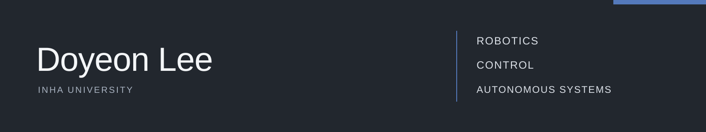

  

## Hi there 👋
**Department of Electrical and Electronic Engineering** student interested in Robotics, Autonomous systems, and Control engineering

🤖 Interested in **Robotics · Autonomous Systems · Computer Vision · Navigation · SLAM · Physical AI**

---

## About Me
- 🎓 Studying **Electrical & Electronic Engineering** with a focus on embedded systems & perception and AI
- 🔭 Currently building projects with **Jetson AGX, Jetson Thor and robot arms**
- 🌱 Learning **ROS, Manipulator, SLAM, VLA, NAVIGATION**
- ⚡ Fun fact: I like systems that *move, see, and think*

---

## 🛠 Skills

| Category | Stack |
| :--- | :--- |
| **Languages** |    |
| **ML / AI** |     |
| **Robotics & Simulation** |     |
| **CAD** |  |
| **Hardware & Tools** |   |
| **Dev Tools** |    |

## Development Environment

| Category | Environment |
| :--- | :--- |
| **OS** |  |
| **ROS** |  |
| **Python** |  |
| **Compute** |   |
